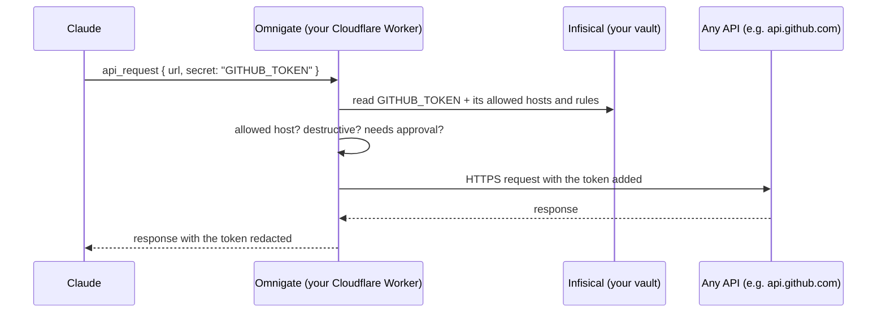

# Omnigate

**Let Claude call any API, AWS service or multi-step workflow — GitHub, Notion, Gmail, Linear, Stripe, Slack, Jira, AWS and more — without ever seeing your tokens.**

Omnigate is a remote [MCP](https://modelcontextprotocol.io) server you deploy once on Cloudflare Workers (free plan). Your API keys live in [Infisical](https://infisical.com), a secrets vault. When Claude needs to call an API, it passes only the secret's **name**. The server looks up the real token, checks the call against your rules, makes it, removes the token from the response and hands back just the result.

- ***Omni***: every HTTPS API, AWS and multi-step task through one server.
- ***Gate***: credentials stay behind it, every action is checked, and risky ones wait for your click.

No more pasting tokens into chat. No token in the model's context, the chat log or any prompt.

```
You:    "List my open GitHub issues and add each one to my Notion task board."
Claude: run_code {
          const issues = await api.get("GITHUB_TOKEN", "https://api.github.com/issues");
          for (const i of issues.body) await api.post("NOTION_TOKEN", "https://api.notion.com/v1/pages", {...});
        }
        → Done. 7 issues added.        (Claude never saw either token.)
```

---

## Contents

- [Why use it](#why-use-it)
- [How it works](#how-it-works)
- [Tools](#tools)
- [Setup (about 20 minutes)](#setup-about-20-minutes)
- [Connect it to Claude](#connect-it-to-claude)
- [Add your API tokens](#add-your-api-tokens)
- [Using it](#using-it)
- [Multi-step work: `run_code`](#multi-step-work-run_code)
- [Agents with a shell: `open_gateway`](#agents-with-a-shell-open_gateway)
- [Approvals for risky actions](#approvals-for-risky-actions)
- [Big files and binary output](#big-files-and-binary-output)
- [Temporary CLI tokens: `issue_temp_token`](#temporary-cli-tokens-issue_temp_token)
- [Security model and limits](#security-model-and-limits)
- [Troubleshooting](#troubleshooting)
- [Local development](#local-development)
- [Project layout](#project-layout)
- [License](#license)

---

## Why use it

| Without Omnigate | With Omnigate |
|---|---|
| You paste a token into the chat, and it sits in the conversation history | Tokens stay in your vault, and Claude only knows their names |
| One MCP server per service (GitHub MCP, Notion MCP, Linear MCP, ...) | **One server for every HTTPS API and AWS** |
| Every API call is a separate tool call, each one filling the context | **`run_code`** does loops, parallel calls and filtering on the server in one call |
| A prompt-injected page could trick the model into sending your token somewhere else | Each token is **locked to its own hosts**; a GitHub token can only ever go to `api.github.com` |
| Deletes and sends happen as soon as the model decides | **Deletes, sends and (optionally) every write need your click** on an approval page |
| Adding a new service means new code or a new server | Add a token with its hosts in Infisical. **No redeploy.** |

**Good for:** anyone who uses Claude (claude.ai, Claude Desktop, Claude Code) with real accounts and wants it to work across many services safely. The tool list is kept short on purpose, so even small models spend few tokens on it.

---

## How it works



- **Sign-in:** the server sits behind Google sign-in. Only emails you list in `ALLOWED_EMAILS` can connect.
- **Vault:** secrets are read live from Infisical, so you add or rotate a token there and it works right away.
- **Read-only server:** Omnigate never creates, edits or deletes secrets. You manage them in the Infisical dashboard, so a tricked model can't change where a token may go.
- **Host lock:** every secret carries a `hosts:` line saying where it may be sent. No line, no sending.

Design and threat model: [docs/design-credential-broker.md](docs/design-credential-broker.md).

---

## Tools

Once connected, Claude sees six tools. You don't call them yourself; just ask Claude in plain language.

| Tool | What it does | Needs your approval? |
|---|---|---|
| **`api_request`** | The main tool. One authenticated HTTPS call to any API using a stored secret; returns the response with the secret redacted. JSON bodies, query params, headers, file uploads, OAuth refresh and AWS signing. | Only for risky calls (see [Approvals](#approvals-for-risky-actions)) |
| **`run_code`** | Multi-step work: Claude writes JavaScript that the server runs in an isolated sandbox. Loops, parallel calls, AWS, filtering big responses, all in one tool call. | Pauses for the same risky calls |
| **`open_gateway`** | For agents with a shell (Claude Code, cloud sessions): use `curl`, SDKs and the real `aws` CLI through the server, with no real credential in the sandbox. | **Always**, with a must-tick box |
| `list_secrets` | Lists secret names, folders, notes, allowed hosts and approval rules. **Never values.** | No |
| `get_upload_url` | Move big files (and binary API output) without sending them through the chat. | No |
| `issue_temp_token` | Last resort for interactive CLIs: a short-lived (1 hour max) Infisical token from a separate limited identity. | **Always**, with a must-tick box |

### Auth types for `api_request`

| `auth_type` | Sends | Use for |
|---|---|---|
| `bearer` (default) | `Authorization: Bearer <token>` | GitHub, Notion, Stripe, Slack, OpenAI, most APIs |
| `header` | `<header_name>: [<header_prefix> ]<token>` | APIs with a custom header, e.g. `X-API-Key`, or Linear (`Authorization: <key>`) |
| `basic` | `Authorization: Basic ...` (secret is `user:password`, or pass `username` and store just the password) | Jira / Confluence (`email:api_token`), Twilio |
| `query` | `?<query_param>=<token>` | APIs that take the key in the URL |
| `oauth2_refresh` | Trades a stored refresh token for a short-lived access token, sent as `Bearer` | Google (Gmail, Drive, Calendar, Sheets), Microsoft Graph |
| `aws` | AWS Signature V4, optionally via STS `AssumeRole` | Any AWS API: DynamoDB, S3, SSM, EC2, ... |

`oauth2_refresh` and `aws` are picked automatically for secrets of that kind.

---

## Setup (about 20 minutes)

### What you need

- A **Cloudflare** account (free plan is fine)
- An **Infisical** account (free plan is fine), on US or EU cloud
- A **Google Cloud** project (for the sign-in screen; free)
- **Node.js 20+** and **git**

### 1. Get the code

```bash
git clone https://github.com/akshay-kumar-bm/omnigate.git
cd omnigate
npm install --legacy-peer-deps
npx wrangler login
```

> `--legacy-peer-deps` is required. Dependencies are pinned on purpose; keep them pinned.

### 2. Pick your server URL

The Worker is named `infisical-mcp` in `wrangler.jsonc` (change `name` if you like), so it will live at:

```
https://infisical-mcp.<your-subdomain>.workers.dev
```

Find `<your-subdomain>` in the Cloudflare dashboard under **Workers & Pages**. This full URL is your **`PUBLIC_URL`**.

### 3. Create the storage Cloudflare needs

```bash
npx wrangler kv namespace create OAUTH_KV
```

Copy the `id` it prints. Approvals and sign-in sessions use a Durable Object, which `wrangler.jsonc` already declares; nothing to create.

### 4. Set up Infisical (your vault)

1. Create a **project** in Infisical. Copy its **Project ID** (Project settings).
2. Create a **Machine Identity** with **Universal Auth** (Organization → Access Control → Identities).
3. Create a **Client Secret** for it. Copy the **Client ID** and **Client Secret**.
4. Add the identity to your project with a role that can **read** secrets. Omnigate never writes secrets, so read access is enough.
5. Note the environment you'll use (default: `dev`).

### 5. Set up Google sign-in

1. In [Google Cloud Console](https://console.cloud.google.com) → **APIs & Services** → **OAuth consent screen**: choose External, fill in the app name, and add your email as a test user.
2. **Credentials** → **Create credentials** → **OAuth client ID** → type **Web application**.
3. Under **Authorized redirect URIs** add `<PUBLIC_URL>/callback`.
4. Copy the **Client ID** and **Client Secret**.

### 6. Fill in the config

`wrangler.jsonc` uses `${NAME}` placeholders for account-specific values:

| Placeholder | What it is |
|---|---|
| `OAUTH_KV_ID` | KV namespace id from step 3 |
| `INFISICAL_PROJECT_ID` | Project ID from step 4 |
| `AGENT_PROJECT_ID` | Separate Infisical project for `issue_temp_token` (optional; see [below](#temporary-cli-tokens-issue_temp_token)) |
| `R2_ACCOUNT_ID` | Your Cloudflare account ID, for `get_upload_url` (optional) |
| `ALLOWED_EMAILS` | Comma-separated Google accounts allowed to sign in |
| `PUBLIC_URL` | Your Worker URL from step 2 |

Also set `INFISICAL_HOST` to `https://eu.infisical.com` if your Infisical is on EU cloud.

- **Deploying with GitHub Actions (recommended):** keep the placeholders in the file and add each value as a repository **variable** (Settings → Secrets and variables → Actions → Variables). The workflow fills them in before deploying and stops if one is missing.
- **Deploying by hand:** replace the placeholders in your local copy and don't commit it.

### 7. Store the server's own secrets

Each command asks you to paste the value:

```bash
npx wrangler secret put INFISICAL_CLIENT_ID
npx wrangler secret put INFISICAL_CLIENT_SECRET
npx wrangler secret put GOOGLE_CLIENT_ID
npx wrangler secret put GOOGLE_CLIENT_SECRET
```

These live on the Worker. Deploys never touch them.

### 8. Deploy

**From GitHub:** `.github/workflows/deploy.yml` deploys on every push to `main` (or by hand: Actions → Deploy → Run workflow). Add the repository **secrets** `CLOUDFLARE_API_TOKEN` (a token with "Edit Cloudflare Workers" permission) and `CLOUDFLARE_ACCOUNT_ID`, plus the variables from step 6.

**By hand:**

```bash
npx wrangler deploy
```

### 9. Check it works

```bash
curl https://infisical-mcp.<your-subdomain>.workers.dev/.well-known/oauth-authorization-server
# 200 with JSON  -> the server is up

curl -i https://infisical-mcp.<your-subdomain>.workers.dev/mcp
# 401 Unauthorized -> correct, you haven't signed in yet
```

---

## Connect it to Claude

Your MCP endpoint is `<PUBLIC_URL>/mcp`.

### claude.ai and Claude Desktop

1. **Settings** → **Connectors** → **Add custom connector**
2. Name: `Omnigate`. URL: your `/mcp` endpoint.
3. Click **Connect** and sign in with a Google account listed in `ALLOWED_EMAILS`.
4. Enable the connector in a chat (the tools menu) and start asking.

### Claude Code

```bash
claude mcp add --transport http omnigate https://infisical-mcp.<your-subdomain>.workers.dev/mcp
```

Then run `/mcp` inside Claude Code and choose **Authenticate** to sign in with Google.

### Other MCP clients

Any client that supports **remote MCP over HTTP with OAuth** works. Point it at the `/mcp` URL; it discovers the sign-in flow automatically.

---

## Add your API tokens

Every token needs two things: a **name** (how Claude refers to it) and **hosts** (where it may be sent). You add them in the Infisical dashboard, so the token never touches the chat.

1. Open your Infisical project → environment `dev`.
2. Create a **folder per service**, e.g. `/github`, `/notion`, `/linear`.
3. Add the secret inside it, e.g. name `GITHUB_TOKEN`, value `ghp_...`.
4. In the secret's **comment**, add a hosts line:
   ```
   hosts: api.github.com, uploads.github.com
   ```
5. Done. Ask Claude "list my secrets" to confirm it shows the hosts. No redeploy.

### Rules for the comment

- `hosts:` takes bare hostnames only: `api.example.com` (no `https://`, path, port, IP or internal domain).
- Wildcards cover subdomains: `*.atlassian.net` matches `yourteam.atlassian.net`, but never the bare `atlassian.net`.
- Wildcards on shared-hosting domains (`*.workers.dev`, `*.github.io`, `*.vercel.app`, `*.amazonaws.com`, ...) are refused, because anyone can register a subdomain there. Name the exact host instead.
- A secret with no `hosts:` line is **never sent anywhere**. Use that for IDs and config values.
- Optional approval rules (`approve: writes`, `approve: all`, `allow: ...`) go in the same comment; see [Approvals](#approvals-for-risky-actions).

### Common services

| Service | Suggested name | `hosts:` line | Auth |
|---|---|---|---|
| GitHub | `GITHUB_TOKEN` | `api.github.com, uploads.github.com` | `bearer` (default) |
| Notion | `NOTION_TOKEN` | `api.notion.com` | `bearer` + header `Notion-Version: 2022-06-28` |
| Linear | `LINEAR_API_TOKEN` | `api.linear.app` | `header`, `header_name: Authorization` |
| Stripe | `STRIPE_SECRET_KEY` | `api.stripe.com` | `bearer` |
| Slack | `SLACK_BOT_TOKEN` | `slack.com` | `bearer` |
| OpenAI | `OPENAI_API_KEY` | `api.openai.com` | `bearer` |
| Jira / Confluence | `JIRA_TOKEN` (value `email:api_token`) | `*.atlassian.net` | `basic` |
| Google | `GOOGLE_OAUTH` (JSON, see below) | `*.googleapis.com` | `oauth2_refresh` |
| AWS | `AWS_ADMIN` (JSON, see below) | per region, e.g. `sts.ap-south-1.amazonaws.com, *.ap-south-1.amazonaws.com` | `aws` |

> Use the narrowest token you can: read-only scopes, one repo, one workspace. The host lock limits *where* a token goes; the token's own scopes limit *what* it can do.

### Google and other OAuth APIs

Google and Microsoft need a short-lived access token instead of a fixed key. Store one secret whose value is JSON; the server trades the refresh token for an access token (cached until a minute before it expires):

```
name:    GOOGLE_OAUTH            (folder /google)
value:   {"client_id":"...","client_secret":"...","refresh_token":"...","token_url":"https://oauth2.googleapis.com/token"}
comment: hosts: *.googleapis.com
```

`token_url`'s host must also be allowed (for Microsoft: `hosts: graph.microsoft.com, login.microsoftonline.com`, plus an optional `scope`). Providers that replace the refresh token on every refresh aren't supported, because Omnigate never writes secrets.

**Getting a Google refresh token:** Google Cloud Console → enable the APIs you want (Gmail, Drive, Calendar, ...) → OAuth consent screen set to **In production** (unverified is fine for your own account; in Testing mode refresh tokens expire after 7 days) → create a **Web application** OAuth client (separate from the sign-in client) with redirect URI `https://developers.google.com/oauthplayground` → in [OAuth Playground](https://developers.google.com/oauthplayground), gear icon → "Use your own OAuth credentials", enter your scopes, authorize, exchange the code for tokens → put the refresh token in the JSON.

Recommended scopes: `gmail.modify` rather than full `https://mail.google.com/` (no permanent delete, filters or forwarding), `calendar.events` rather than `calendar`, plus `drive`, `documents`, `spreadsheets` as needed.

### AWS

Store one secret per AWS identity, value as JSON. The server signs every request with SigV4 and the key never leaves it:

```
name:    AWS_ADMIN               (folder /aws)
value:   {"access_key_id":"AKIA...","secret_access_key":"...","region":"ap-south-1","role_arn":"arn:aws:iam::123456789012:role/agent"}
comment: hosts: sts.ap-south-1.amazonaws.com, *.ap-south-1.amazonaws.com
         approve: writes
         allow: aws dynamodb:PutItem
```

- `role_arn` is optional but recommended: the stored keys are then used only for `sts:AssumeRole`, and requests are signed with 15-minute role credentials, so the role's IAM policy caps what any request can do. Optional `external_id`, `session_seconds`, `session_token`.
- Add `iam.amazonaws.com` to `hosts:` if you use IAM.
- AWS approvals follow the **action**, not the HTTP method: `Describe*`, `Get*`, `List*`, `Query`, `Scan` and S3 `GET` are reads; `Delete*`, `Terminate*`, `Stop*`, `Revoke*`, IAM/KMS/Organizations changes, `ssm:SendCommand` and `iam:CreateAccessKey` always need approval. See `src/aws.ts`.
- Responses that contain secrets (`secretsmanager:GetSecretValue`, SSM `SecureString`, `sts:AssumeRole`, `kms:Decrypt`, ...) go into the [session vault](#session-vault) instead of to Claude.

---

## Using it

Just talk to Claude. Some things to try:

- "What secrets do I have stored?"
- "Show my GitHub notifications from today."
- "Create a Linear issue titled 'Fix login bug' in the Web team."
- "Find the Notion page called Roadmap and add a bullet: Ship v2 in March."
- "Summarise my unread Gmail and draft replies."
- "Who am I on AWS, and what's in the `users` DynamoDB table?"

Under the hood Claude makes calls like:

```text
api_request { url: "https://api.github.com/user", secret: "GITHUB_TOKEN" }

api_request { url: "https://api.notion.com/v1/users/me", secret: "NOTION_TOKEN",
              headers: { "Notion-Version": "2022-06-28" } }

api_request { url: "https://api.linear.app/graphql", method: "POST", secret: "LINEAR_API_TOKEN",
              auth_type: "header", header_name: "Authorization",
              body: { query: "{ viewer { name } }" } }

api_request { url: "https://gmail.googleapis.com/gmail/v1/users/me/messages", secret: "GOOGLE_OAUTH" }
```

**Uploading a file** (up to 5 MB) works with `multipart` or `body_base64`. For example, attaching an image to a Notion page takes three calls: create a file upload, send the bytes with `multipart`, then reference the upload id on the page. For bigger files see [Big files](#big-files-and-binary-output).

**Secrets in several folders:** `api_request` finds a secret by name in any folder. If the same name exists in two folders, it refuses to guess and asks for `path` (e.g. `path: "/github"`).

### Session vault

Some calls return values the model shouldn't see, such as an API key an admin call just created. Pass `capture` and the server keeps them:

```text
api_request { ..., capture: { newkey: "$.key" } }   → the response shows vault:newkey
```

Later calls use `secret: "vault:newkey"`, or the handle inside double curly braces in a header, URL or body; the server substitutes it right before sending and redacts it. Values last 60 minutes by default (`capture_minutes`, max 24 h). A vault value may only go to the hosts of the secret that produced it; sending it elsewhere needs an approval.

---

## Multi-step work: `run_code`

For anything that takes more than one call, Claude writes JavaScript and the server runs it in an isolated sandbox with **no network and no secrets**. The only way out is a set of helpers that run through the same checks as `api_request` (hosts, approvals, redaction, vault):

```js
// run_code { purpose: "check user 1 and my repos", secrets: ["AWS_ADMIN", "GITHUB_TOKEN"], code: `...` }
const [item, repos] = await Promise.all([
  aws.call("AWS_ADMIN", { service: "dynamodb", action: "GetItem",
    params: { TableName: "users", Key: { id: { S: "1" } } } }),
  api.get("GITHUB_TOKEN", "https://api.github.com/user/repos", { pick: ["$[*].full_name"] }),
]);
return { user: item.body.Item, repos: repos.body.map(r => r.full_name) };
```

- **Helpers:** `api.get/post/put/patch/delete/request` (same arguments as `api_request`), `aws.call` (JSON and query AWS APIs; XML is parsed), `aws.request` (REST AWS APIs such as S3), `vault.list/delete`, `sleep`, `input`, `console.log`. Only the return value and logs come back (up to 100 KB), so Claude filters big data on the server.
- **Engines:** on the free plan the code runs in **QuickJS** (compiled to WebAssembly inside the Worker). With a Workers Paid plan, uncomment the `LOADER` binding in `wrangler.jsonc` to run each job in a fresh **Dynamic Worker** (real V8, much faster). If that doesn't work on your plan, `run_code` falls back to QuickJS by itself.
- **Big responses:** a response over 60 KB comes back with `truncated: true`, a `sample` of its shape (keys, types, array lengths, first item) and a hint. Pass `pick: ["$.results[*].id", "$.has_more"]` to fetch only those fields.
- **Approvals pause the run.** A call that needs approval stops the run with an approval link. After you approve, Claude resumes with just the `run_id`; finished calls are replayed from a journal, never repeated, and the approval is bound to that exact call.
- **Free-plan limits handled for you:** Cloudflare allows 50 outbound requests per invocation, so the server splits long runs into segments and continues by itself (up to ~280 calls per tool call). Beyond that it returns a checkpoint and Claude resumes it by id.
- **Failures keep finished work:** a failed run keeps its completed calls for an hour; after fixing the cause, resuming retries only the failed calls.
- Limits: 300 calls per run, 6 in flight, 120 s wall time by default (max 600), about 10 ms of CPU on the free plan, so code should orchestrate and filter rather than compute.

---

## Agents with a shell: `open_gateway`

For Claude Code and cloud sessions that want `curl`, an SDK or the real **`aws` CLI**, with nothing to install and no real credential in the sandbox. `open_gateway { secrets: ["AWS_ADMIN", "GITHUB_TOKEN"], minutes: 30, purpose: "..." }` always needs approval (with a tick box) and returns a **gateway token** plus lines to run:

```bash
export GATEWAY_TOKEN='gwt_...'
curl -sS -H "Authorization: Bearer $GATEWAY_TOKEN" <PUBLIC_URL>/gw/GITHUB_TOKEN/api.github.com/user

export AWS_ACCESS_KEY_ID=GW... AWS_SECRET_ACCESS_KEY=gateway-dummy-key AWS_SESSION_TOKEN="$GATEWAY_TOKEN"
export AWS_ENDPOINT_URL=<PUBLIC_URL> AWS_REGION=ap-south-1
aws dynamodb get-item --table-name users --key '{"id":{"S":"1"}}'
```

- **HTTP:** `<PUBLIC_URL>/gw/<SECRET>/<api-host>/<path>`, with the gateway token where the API key would go.
- **AWS:** the CLI signs with a dummy key; the server checks the gateway token, then signs again with the real (or AssumeRole) credentials. Works with the AWS CLI, boto3 and the other SDKs.
- Same rules as `api_request`. A request that needs approval fails with a link; after you approve, re-running the identical command goes through.
- The gateway token only works on this server, only for the listed secrets, for at most 60 minutes.
- Not supported: commands that sign locally (`aws s3 presign`, `aws eks get-token`) and interactive `aws ssm start-session`.

---

## Approvals for risky actions

Some actions need a human, and the **server** enforces it, not the model.

**Always need approval:**

- `api_request` / `run_code` / gateway calls that look destructive:
  - method `DELETE`
  - GraphQL mutations whose names contain delete / destroy / remove / archive / purge / trash (e.g. Linear `issueDelete`)
  - JSON bodies that set `archived`, `trashed`, `deleted` or `in_trash` to `true` (how Notion and GitHub archive)
  - URLs ending in a trash/delete action (`/trash`, `/delete`, `/batchDelete`, `/emptyTrash`, `:delete`)
  - Gmail send (`messages/send`, `drafts/send`), which can't be undone
  - destructive AWS actions (see [AWS](#aws))
- `open_gateway` and `issue_temp_token`, every time

Everything else (reads, creates, ordinary updates) runs right away, unless you turn on strict mode.

**Strict mode for powerful credentials.** Pattern detection can't know every way an API can lose data (a Docs `batchUpdate` delete, a Gmail label, sharing a Drive file). So for a powerful token, flip the rule in the secret's comment:

```
hosts: *.googleapis.com
approve: writes
allow: POST gmail.googleapis.com/gmail/v1/users/me/drafts
allow: POST sheets.googleapis.com/v4/spreadsheets/<sheet id>/values/*:append
```

- `approve: writes`: every `POST`/`PUT`/`PATCH`/`DELETE` with this secret needs approval. Reads don't.
- `approve: all`: every call, reads included (for production secrets).
- `allow: METHOD host/path`: the only writes that skip approval. Exact host, whole path, `*` matches within one path segment. An allow line never waives approval for `DELETE` or the destructive patterns above.
- `list_secrets` shows these rules, so Claude can prefer an allowed action (a draft instead of a send).

**What you see:**

1. Claude says the action needs approval and gives you a link.
2. You open it. The first time, you sign in with Google; that keeps you signed in for 12 hours, so later approvals are one click.
3. The page explains the action in plain words ("Create Google Sheet 'Email Summaries' with 31 rows × 7 columns"), previews the first rows of any list in the body, and shows the method, host, path and full body. Gmail sends are decoded into From / To / Cc / **Bcc** / **Reply-To** / Subject / attachments, with the fields that can quietly copy or redirect mail highlighted.
4. Press **Approve** or **Deny**, then tell Claude you approved. It repeats the identical call, which now runs.

An approval works **once**, only for **that exact action**, and expires after **15 minutes**. Claude can't approve for you: it never has your browser session.

---

## Big files and binary output

**Uploading:** `get_upload_url` gives Claude a one-time upload URL (5 minutes, first write only). It runs one `curl -T <file> <url>` from its own machine and gets a download URL (1 hour) to hand to another API, e.g. as `api_request`'s `body_source` or a multipart file's `source` (up to 40 MB). The file never passes through the chat.

**Saving output:** pass `save_response: true` to `api_request` and a successful response (audio, images, PDFs, exports) is stored and returned as a download URL instead of the body. For example, text-to-speech in one call:

```json
{ "url": "https://api.elevenlabs.io/v1/text-to-speech/<voice id>", "method": "POST",
  "auth_type": "header", "header_name": "xi-api-key", "secret": "ELEVENLABS_API_KEY",
  "body": { "text": "Hello", "model_id": "eleven_multilingual_v2" }, "save_response": true }
```

Files are deleted after 1 day. One-time setup with Cloudflare R2:

```bash
npx wrangler r2 bucket create <bucket>
npx wrangler r2 bucket lifecycle add <bucket> --name expire-tmp --prefix tmp/ --expire-days 1
# Cloudflare dashboard → R2 → Manage API tokens → Object Read & Write on that bucket, then:
npx wrangler secret put R2_ACCESS_KEY_ID
npx wrangler secret put R2_SECRET_ACCESS_KEY
```

Then set `R2_ACCOUNT_ID` and `R2_BUCKET` in `wrangler.jsonc` and deploy again. Until this is done, `get_upload_url` replies with these steps.

---

## Temporary CLI tokens: `issue_temp_token`

A last resort for interactive CLIs that `open_gateway` can't cover. `issue_temp_token` gives Claude a short-lived Infisical token to use with `infisical run -- <command>`:

- It uses a **separate, limited "agent" identity**, never the server's own.
- Every request shows you the purpose, project, folder and lifetime. You must **tick a box** to give it.
- The server refuses identities whose tokens live longer than 1 hour.

Setup: create a second Machine Identity with a short token TTL (15–60 min) and a read-only role, then:

```bash
npx wrangler secret put AGENT_INFISICAL_CLIENT_ID
npx wrangler secret put AGENT_INFISICAL_CLIENT_SECRET
```

Set `AGENT_PROJECT_ID` to a separate small project so temp tokens can't reach your main vault. Full guide: [docs/agent-access.md](docs/agent-access.md).

---

## Security model and limits

**What protects your tokens**

- **Values never come back.** `list_secrets` never returns values, and every response has the token redacted from its body and headers.
- **Read-only server.** No tool can create, edit or delete a secret, so the owner alone decides where each token may go.
- **Host lock.** A token is only sent to the hosts in its own `hosts:` line.
- **Sandboxed code.** `run_code` runs without network or secrets; every call goes back through the same checks.
- **No redirects.** Redirects are never followed, since the next hop could be a host the token isn't allowed to reach.
- **No secret-in-secret leaks.** `${OTHER_SECRET}` references are never expanded.
- **No header tricks.** Claude can't set its own `Authorization` header, and method-override headers are refused, so a `DELETE` can't be disguised.
- **Human approval** for deletes, sends, strict-mode writes, gateways and temp tokens.
- **Sign-in allowlist.** Only `ALLOWED_EMAILS` can connect.

**Limits**

- HTTPS only, default port only
- 3-minute timeout per request
- Responses capped at 60 KB (`run_code` adds samples and `pick` for bigger ones)
- Uploads through `api_request` capped at 5 MB (40 MB via `get_upload_url`)
- Detecting non-`DELETE` destructive calls is best effort (`src/destructive.ts`); use `approve: writes` for tokens where that matters.
- Not covered: an agent that reads your data and leaks it through its own shell. Run sensitive automations without a shell or with network access restricted.

---

## Troubleshooting

| Problem | Fix |
|---|---|
| **"Secret X is not allowed to be sent to &lt;host&gt;"** | The secret's `hosts:` line doesn't include that hostname. Edit the comment in Infisical. |
| **"Secret X exists in several folders"** | Two secrets share the name. Pass `path`, or rename one. |
| **Google says `redirect_uri_mismatch`** | The redirect URI in Google Cloud must be exactly `<PUBLIC_URL>/callback`. |
| **"This Google account is not allowed."** | Your email isn't in `ALLOWED_EMAILS`. Add it and redeploy. |
| **`/mcp` returns 401** | Expected before sign-in. Connect through Claude, which runs the sign-in flow. |
| **Infisical errors (401/403)** | Check `INFISICAL_CLIENT_ID` / `INFISICAL_CLIENT_SECRET`, that the identity is added to the project, and that `INFISICAL_HOST` matches your region (US/EU). |
| **Google refresh token stops working after a week** | Your OAuth consent screen is in Testing mode. Set it to In production and get a new refresh token. |
| **Deploy workflow fails at "Fill in deployment config"** | A repository variable from [step 6](#6-fill-in-the-config) is missing. |
| **`run_code` returns `checkpoint: true`** | Normal for long jobs. Claude resumes it with the `run_id`. |
| **`get_upload_url` or `issue_temp_token` only return setup steps** | Their optional setup isn't done yet. See the sections above. |
| **`npm install` fails** | Use `npm install --legacy-peer-deps`. |

---

## Local development

Create `.dev.vars` (git-ignored):

```ini
INFISICAL_CLIENT_ID=...
INFISICAL_CLIENT_SECRET=...
GOOGLE_CLIENT_ID=...
GOOGLE_CLIENT_SECRET=...
PUBLIC_URL=http://localhost:8787
```

Fill the `wrangler.jsonc` placeholders in your local copy (don't commit them), add `http://localhost:8787/callback` as a redirect URI in Google Cloud, then:

```bash
npm run dev         # wrangler dev on http://localhost:8787
npm run typecheck   # run before every push
```

There's no test suite yet. Contributions are welcome.

---

## Project layout

```
src/
  index.ts           entry point: OAuth provider (/mcp, /authorize, /token) and gateway routing
  server.ts          MCP server and the six tools
  api-call.ts        api_request: auth types, host check, uploads, redaction
  api-schema.ts      api_request arguments, shared with run_code's api.request()
  run-code.ts        run_code on Dynamic Workers (paid plan)
  quick-run.ts       run_code on QuickJS (free plan)
  quickjs-wasm.ts    loads the bundled QuickJS WebAssembly module
  broker-rpc.ts      the only door from the sandbox back to the server
  shape.ts           samples and `pick` for big run_code results
  gateway.ts         open_gateway: /gw/ HTTP proxy and AWS CLI re-signing
  aws.ts             AWS credentials, AssumeRole, endpoints, per-action classification
  vault.ts           session vault for captured values
  policy.ts          which calls need a human (one place for every way in)
  destructive.ts     detects destructive requests beyond HTTP DELETE
  preview.ts         plain-language approval summaries, Gmail decoding
  approvals.ts       approval records and the /approve pages
  approval-store.ts  Durable Object for approvals, sessions and nonces
  store-core.ts      expiry logic for the store
  hosts.ts           validation and parsing of the "hosts:" comment line
  google-handler.ts  Google sign-in, consent page, /callback
  infisical.ts       small Infisical REST client (Universal Auth, read-only)
  uploads.ts         get_upload_url and saved responses (R2 presigned URLs)
  temp-token.ts      issue_temp_token
  guide.ts           setup and usage text for issue_temp_token
docs/
  design-credential-broker.md   design and threat model
  agent-access.md               full guide for temporary CLI access
wrangler.jsonc       Worker config (placeholders filled at deploy time)
.github/workflows/deploy.yml    deploys on push to main
```

---

## License

MIT, see [LICENSE](LICENSE).
